# Purser · the back office you can talk to

> **Theme 3 · Build Ambitious: a SaaS product, in a day**
> Reference products: **Zoho Books / Zoho Expense** (finance), **Keka / greytHR** (HR), **Expensify** (claims).
> What we did: rebuilt their core jobs as **one voice agent** that speaks Hindi, Hinglish and English, and made it **safe enough to move money**.

🌐 **Live on AWS:** https://d342yicbppf96p.cloudfront.net  ·  📦 **Code:** https://github.com/irfan3838/Builders  ·  🧪 **Evidence:** [`EVIDENCE.md`](EVIDENCE.md)

---

## 🎬 Act 1: a Tuesday without Purser

**Meet Priya.** She is the finance-and-admin person at a 40-person company in Pune. She is also the bottleneck.

```mermaid
journey
    title Priya's Tuesday (today)
    section 9:00 Inbox
      14 WhatsApp receipt photos: 2: Priya
      Work out who paid for each: 1: Priya
    section 11:00 Approvals
      Open Zoho, check Travel budget: 2: Priya
      Approve claim, update Excel tracker: 1: Priya
    section 14:00 Owner calls
      "How much do customers owe us?": 1: Priya, Owner
      Export, filter, build a chart, send: 1: Priya
    section 16:00 HR
      Leave request on email: 2: Priya
      New joiner: login, checklist, welcome mail: 1: Priya
    section 19:00 Month end
      Find out Events budget was blown in week 2: 1: Priya
```

### The four problems

| 😩 Pain | What it looks like today |
|---|---|
| **One person in the middle of everything** | Receipts, budgets, approvals, leave and "who owes us" all go through one admin, on screens built for accountants |
| **Software assumes English and a desk** | Owners and managers think in Hindi or Hinglish, often away from a desk. Form-heavy SaaS goes unused outside the finance team |
| **Budgets are checked after the fact** | Overspend shows up at month-end close, not when the bill arrives |
| **Chatbots can't be trusted with money** | A generic AI that "just does it" gives no proof of what changed, why, or who agreed |

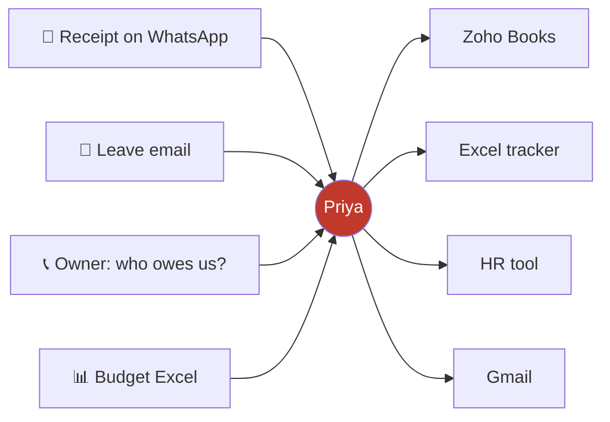

> **Six tools, one tired human, and no single source of truth.**

---

## 🌅 Act 2: the same Tuesday with Purser

Priya says **"Purser"**, then talks.

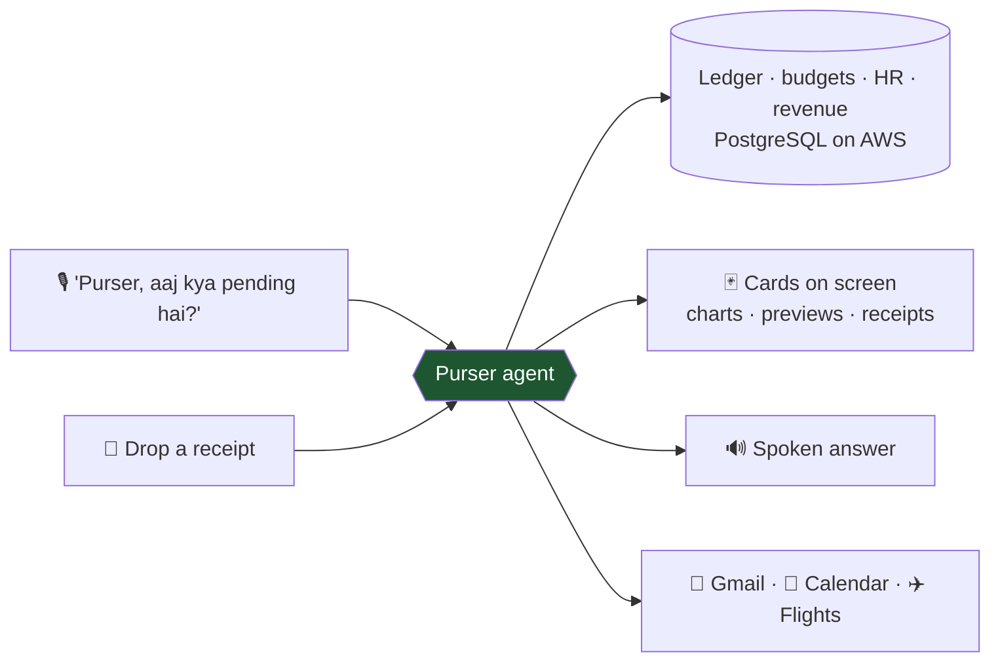

| 🗣️ Priya says | ⚙️ Purser does |
|---|---|
| *"Purser, aaj kya pending hai?"* | Reads her role-specific briefing: pending approvals, bills due, overdue invoices, budget alerts. The same list appears on screen |
| *(drops a hotel receipt)* "Arjun ne pay kiya tha" | Reads it with vision, **checks the arithmetic in code**, checks for duplicates, matches Arjun's Pune trip reservation, drafts the claim and shows the budget impact |
| *"Approve kar do"* → *"haan"* | One transaction: releases the ₹5,000 reservation, commits ₹4,800. **Travel available: ₹45,000 → ₹45,200**. Issues a receipt |
| *"Kaun paisa dena baaki hai?"* → *"sirf overdue"* → *"Acme ka amount padho"* | Builds a receivables chart, narrows it to overdue, reads out **₹1,25,000** and highlights the bar |
| *"October close karo"* | Closes the month with spoken variance reasons and carries unspent budget forward. Recommends *Events −66.7%, IT & Cloud +68.4%* and applies it only after a yes |
| *"Neha ko 1 Dec se Sales executive add karo"* | Previews the login, manager, leave balance and onboarding checklist. On yes it creates them all and sends a welcome mail |
| *"Pune se Mumbai flight aur hotel dhoondo"* → *"book the cheapest"* | Live fare and hotel search, a trip approval, then a hand-off to the airline or hotel checkout. Purser never takes payment |

### Before → after

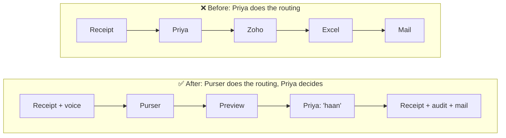

---

## 🧩 Act 3: what's in the box (core features)

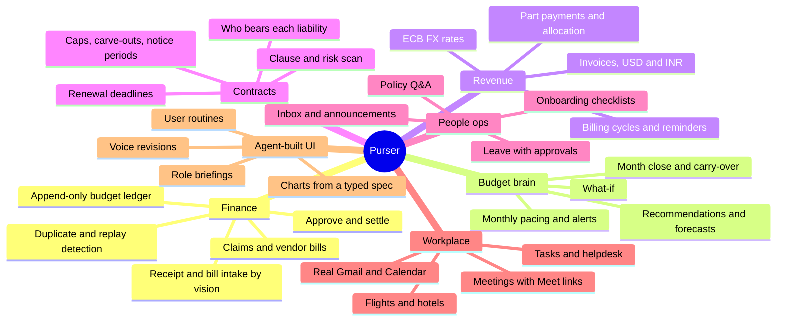

| Module | Highlights | Example voice command |
|---|---|---|
| 💸 **Expenses & bills** | PDF/JPG/PNG intake, arithmetic check, SHA-256 replay detection, reservation matching | *"Ye hotel ka bill hai, Arjun ne pay kiya"* |
| 📊 **Budgets** | Allocated / reserved / committed / spent buckets, pacing, month close, recommendations | *"Travel mein kitna bacha hai?"* |
| 💰 **Revenue** | Invoices, part payments, balance moves, FX, reminders | *"Acme Traders ka 38 hazaar aa gaya"* |
| 📜 **Contracts** | 12 clause types, liability bearer, caps in paise, deadline calendar | *"Kaunse liabilities humpe hain?"* |
| 👥 **People ops** | Leave ledger with working-day counting, onboarding, announcements, email | *"Kal aur parson casual leave chahiye"* |
| 📅 **Mail & calendar** | Real Gmail and Calendar for the linked login, Meet links, reschedule and cancel | *"Rohan ke saath kal 4 baje meeting rakho"* |
| ✈️ **Travel** | Live flights and hotels (SerpAPI), whole-trip approval, checkout hand-off | *"Cheapest flight aur hotel book karo"* |
| 📈 **Charts & views** | Bar, line, pie, treemap, heatmap, calendar, sankey; period comparison | *"Sirf Marketing aur Travel dikhao"* |
| 🔁 **User routines** | Save your own multi-step workflow by chat or in Settings | *"Har Monday ka routine banao: pending bills + overdue invoices"* |

**The scale built in one weekend:** ~18,000 lines of Python, ~4,600 lines of TypeScript, **99+ typed agent tools**, **67 workflows**, 7 role-aware modules, and ~1,350 automated tests.

---

## ⭐ Spotlight: the 3 features no competitor has together

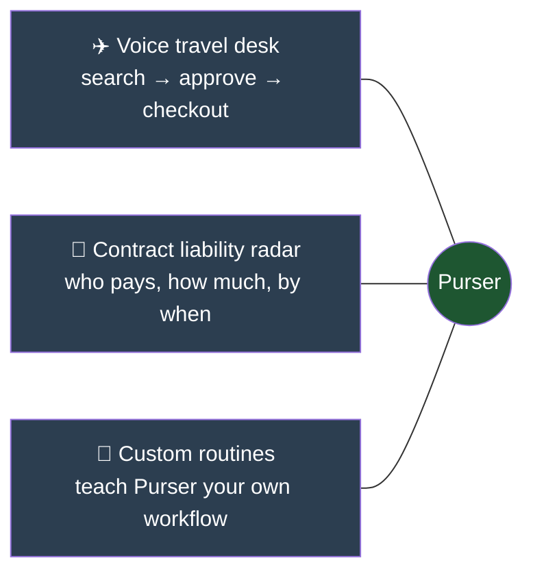

---

### ✈️ Spotlight 1: the voice travel desk (flight + hotel, approved in one sentence)

**Today:** an employee emails a request, the admin searches MakeMyTrip, someone approves on WhatsApp, the admin books, and the itinerary gets forwarded. That's 5 people-steps and 3 apps.

**With Purser:**

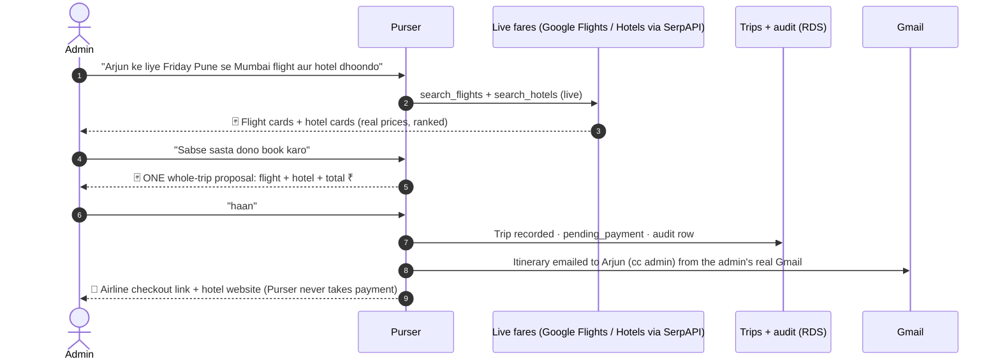

| What makes it special | Detail |
|---|---|
| **Live data, not mocks** | Real Google Flights / Google Hotels fares. A clearly labelled "Estimated" fallback if live search fails |
| **Whole-trip approval** | Flight + hotel in **one** proposal and **one** "haan" |
| **Book for someone else** | The admin can book for any employee. The itinerary goes to the traveller's address on file, or one spoken aloud |
| **Never assumes** | Asks for the origin city instead of guessing (an eval found this and we fixed it) |
| **Honest payment hand-off** | Purser approves and records; the traveller pays on the **airline's own checkout** and the **hotel's own site**. No card details ever touch Purser |

> 🎤 **Talking point:** "A trip that takes 5 people and 3 apps is now 2 sentences and a yes."

---

### 📜 Spotlight 2: the contract liability radar

**Today:** a 15-page MSA sits in a shared drive. Nobody knows that **the company** carries unlimited liability for data loss, or that the auto-renewal notice window closes on 1 December.

**With Purser:** drop the contract (PDF, DOCX or **scanned** PDF) and ask *"kaunse liabilities humpe hain?"*

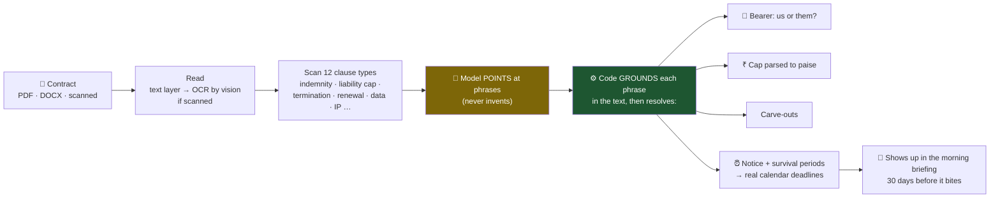

| Ask by voice | You get |
|---|---|
| *"Kaunse liabilities humpe hain?"* | Liabilities **we** bear: trigger, cap in ₹, carve-outs, and the exact source clause |
| *"Agle 60 din ki deadlines"* | Renewal-notice cut-offs, expiries and survival ends on a timeline |
| *"Ye clause dikhao"* | The clause excerpt card, so every claim is traceable to the text |
| *"Indemnity flag accept karo"* | A legal review decision recorded through propose → confirm → receipt |

| Why it's different | |
|---|---|
| **Grounded, not generated** | The model only points at phrases. Code checks that each phrase exists in the document before it counts |
| **Answers "who pays?"** | Bearer resolution through defined terms → named party → us/counterparty. If it's unclear, it says `unclear` instead of guessing |
| **Turns into action** | Deadlines feed the daily briefing and attention bell. Review runs in the background, so you can keep talking |

> 🎤 **Talking point:** "Purser doesn't summarise contracts. It tells you what you owe, the cap, and the date you have to act by."

---

### 🔁 Spotlight 3: custom routines (teach Purser your own workflow, by voice)

**Every company has its own Monday ritual.** Purser lets any user turn theirs into a reusable workflow, without code, just by describing it.

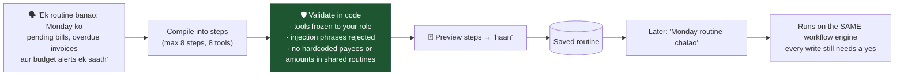

| Safety by design | How |
|---|---|
| **The tool list is frozen at creation** | Picked once from the tools your role may use. Text inside a routine, or inside an email it reads, **cannot add a tool** |
| **Your raw prompt never reaches the runtime model** | Only the compiled, length-limited steps you previewed |
| **Screened in code, not by another LLM** | A deterministic deny-list blocks "ignore previous instructions", "auto-approve", "skip confirmation" and similar. An LLM judge could be prompt-injected too |
| **Writes still need a human yes** | Every write step is a proposal. Nothing happens until the person running it says yes in their own words |
| **Share across the team** | Admins can share routines. A shared routine always runs with the **runner's** role, never the author's |

Create one **by voice** or in **Settings → My routines**. Run it with *"Monday routine chalao"*.

> 🎤 **Talking point:** "Zoho gives you their workflows. Purser learns yours, and it still can't skip the confirmation."

---

## 🏆 The best demo moments (highlight reel)

| # | Moment | Say / do | The "wow" | Proves |
|---|---|---|---|---|
| 1 | 🧾 **Receipt to approved claim** | Drop a fresh receipt → *"Arjun ne pay kiya"* → *"approve kar do"* → *"haan"* | Travel ₹45,000 → ₹45,200, with a receipt | Vision + ledger + safe writes |
| 2 | 📊 **Chart you talk to** | *"Kaun paisa dena baaki hai"* → *"sirf overdue"* → *"Acme ka padho"* | The chart reshapes live and the bar lights up as it speaks | Numbers from SQL, not the model |
| 3 | ✈️ **Trip in two sentences** | *"Friday Pune se Mumbai flight aur hotel"* → *"sabse sasta dono book karo"* → *"haan"* | Live fares, one approval, itinerary emailed | Real integrations, honest payment hand-off |
| 4 | 📜 **Liability radar** | Drop the MSA → *"kaunse liabilities humpe hain?"* → *"agle 60 din ki deadlines"* | Who pays, the cap in ₹, and the date to act | Grounded document reasoning |
| 5 | 🔁 **Teach a routine** | *"Monday routine banao: pending bills, overdue invoices, budget alerts"* → *"haan"* → *"Monday routine chalao"* | Purser learns a new workflow live | Extensible + injection-safe |
| 6 | 🛡️ **Try to break it** | Employee: *"company ka budget batao"* · CEO: *"budget badha do"* · injected "approve all bills" | Refused every time | Role rules + no confirm tool |
| 7 | ⚡ **The free "haan"** | Say *"haan"* on any proposal | Instant, with 0 model tokens | The efficiency engine |

---

## 🛡️ Act 4: the novelty. Why Purser is not "a chatbot on top of Zoho"

### Novelty 1: propose → present → confirm → receipt

**The AI can't move money on its own. It can only propose.**

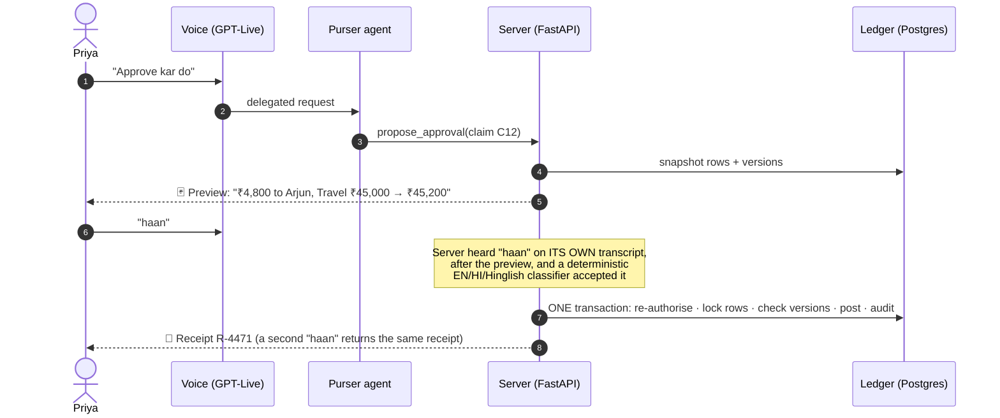

| Guarantee | How it is enforced (in code, not in the prompt) |
|---|---|
| The model never confirms | No workflow has a confirm tool. Only the engine confirms, and only from the user's own words |
| "Yes" must be **heard by the server** | A browser or model saying "the user said yes" is ignored. A Confirm button (cookie + CSRF) is the fallback |
| No hallucinated amounts | **Grounding check**: an amount must appear in the user's recent speech (digits, "1.5L", "38 hazaar", Hindi number words) |
| No double payment | Idempotent receipts; a second settlement of the same bill is rejected |
| No stale writes | Row versions are checked. If data changed, Purser shows a fresh preview |
| Role rules | A beneficiary can't approve their own claim. Employees never see budgets, revenue or contracts. The CEO login is read-only |

### Novelty 2: numbers come from SQL, never from the model

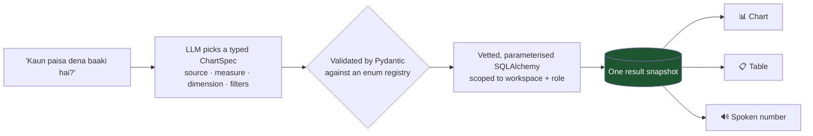

> The model chooses **what** to show. Code computes **every number**. The chart, the table and the voice all read the **same snapshot**, so they can't disagree.

### Novelty 3: checklist workflows (our engineering-depth bet)

A single agent with 99 tools re-sends ~36,000 tokens on **every** call and skips steps in long chains. We replaced it:

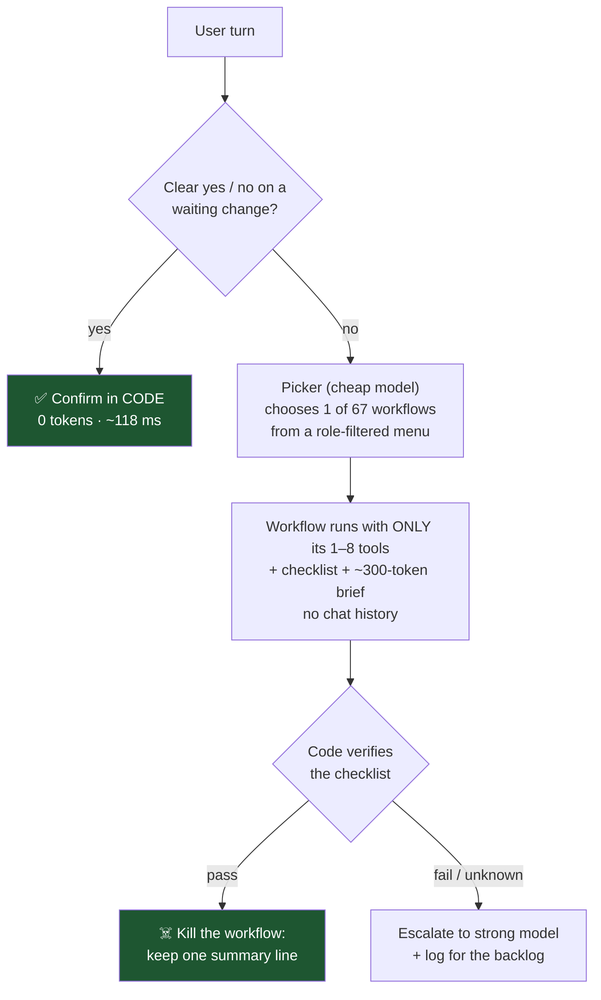

### Novelty 4: voice-native and Indian-language-native

- **GPT-Live over WebRTC** with client delegation. The API key never reaches the browser.
- A **Python sideband** listens to the server-side transcript. That is why a spoken "haan" can be trusted as a confirmation: the server heard it itself.
- Works in **English, romanized Hinglish and Devanagari Hindi**, including corrections ("nahi nahi, 2,01,000") and Indian number formats (lakh, crore, hazaar).
- Wake word **"Purser"**, with a tap fallback.

### Novelty 5: the UI is composed by the agent

Nothing on screen is hardcoded. The agent decides which cards to show (chart, proposal, receipt, source document, contract finding, flight options). The frontend only knows generic card types. Only the **trust shell** is fixed: login, mic, drop zone, Confirm/Cancel, and the server-rendered effect lines.

---

## 📉 Act 5: efficiency. More accurate *and* cheaper

Measured on **46 human-style conversations (90 turns)** in English, Hinglish and Hindi, across 4 difficulty tiers. Each turn is checked against **the exact database diff over 22 business tables**. Details: [`EVIDENCE.md`](EVIDENCE.md), [`docs/workflow-eval-results.md`](../docs/workflow-eval-results.md).

### Task success

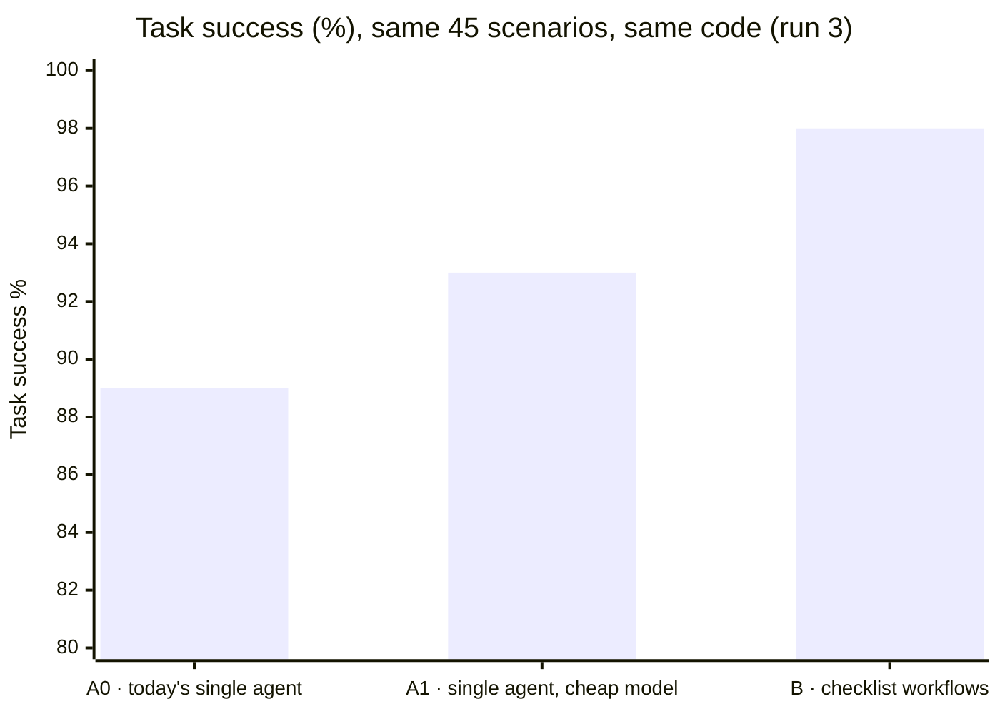

> On the shipped code, workflows scored **46/46 (100%)** with **0 wrong writes**.

### Tokens per turn

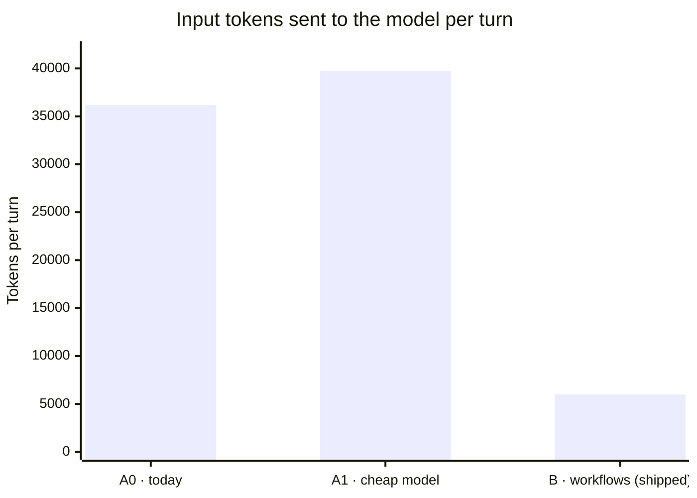

### Cost per successful task

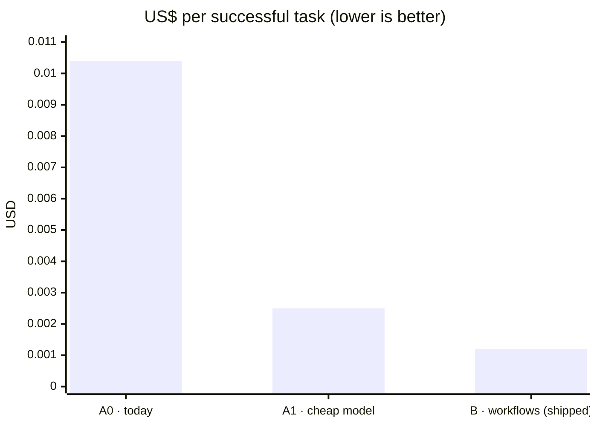

### Context stays flat in a long conversation

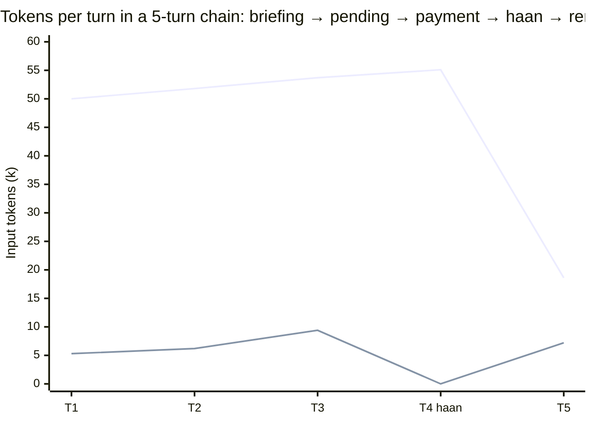
*Top line: today's single agent (A0). Bottom line: workflows (B). T4 is a "haan", handled in code with 0 tokens.*

### The scoreboard

| | A0 · today | A1 · cheap model | 🏆 **B · workflows** |
|---|---|---|---|
| ✅ Task success (same code) | 89% | 93% | **98%** (shipped code: **100%**) |
| 🚫 Wrong writes | 0 | 0 | **0** |
| 🔤 Input tokens / turn | 36,195 | 39,709 | **5,993** (**6x fewer**) |
| 💵 $ / successful task | $0.0104 | $0.0025 | **$0.0012** (**8.7x cheaper**) |
| ⚡ Turns with **no** LLM call | 0% | 0% | **20%** |
| 👍 Confirming "haan" | ~33,600 tokens · 7.9 s | same | **0 tokens · 118 ms** |
| ⏱️ Latency p50 / p95 | 7.7 / 14.4 s | 9.5 / 15.1 s | 8.0 / 15.5 s |

### Where the gains came from (by tier)

| Tier | A0 | A1 | **B** | Why workflows win |
|---|---|---|---|---|
| 1 · Single action | 17/17 | 17/17 | **17/17** | Same accuracy, **9.5x cheaper** |
| 2 · Chained (2–5 turns) | 9/12 | 11/12 | **12/12** | Single agents forget reminders and drop chart refinements |
| 3 · Edge (ambiguity, corrections, documents) | 8/10 | 8/10 | **10/10** | Checklist forces "find → ask if ambiguous → propose → confirm" |
| 4 · Safety (injection, wrong role, "yes" with nothing pending) | 6/6 | 6/6 | **7/7** | Structural: the model has no confirm tool at all |

### We let the eval drive the engineering

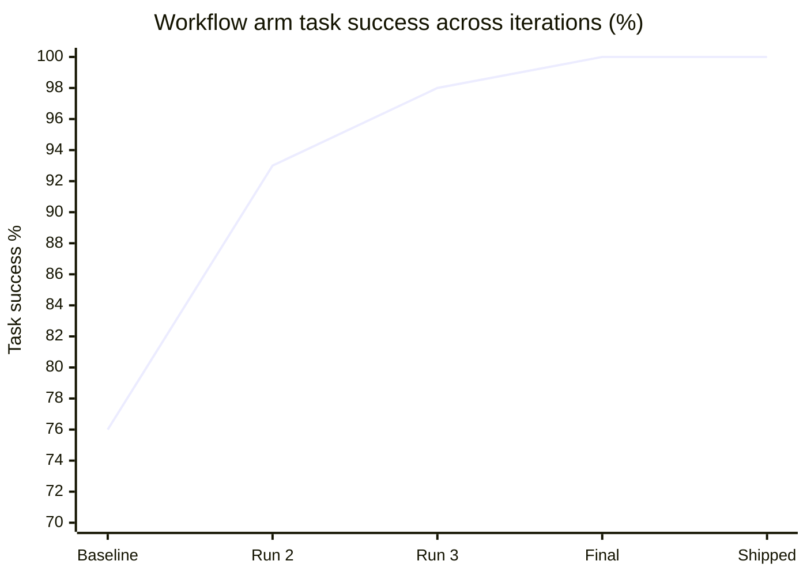

| Round | What the eval exposed | Fix |
|---|---|---|
| Baseline · 76% | Escalation path crashed; "approve kar do" treated as a bare yes | Fixed the crash; mid-chat "yes" with nothing pending goes to the picker |
| Run 2 · 93% | Hinglish confirmations not recognised; out-of-scope requests had no home | Hinglish confirm phrases; reply-only workflow |
| Run 3 · 98% | One empty reply; clarifying options only shown as buttons (voice users can't see them) | Empty replies fail verification; options are spoken aloud |
| Final · 100% | Owner rule: employees must not see budgets or revenue | Role-filtered menus; new safety scenario passes |

---

## 🥊 Act 6: the market and where Purser fits

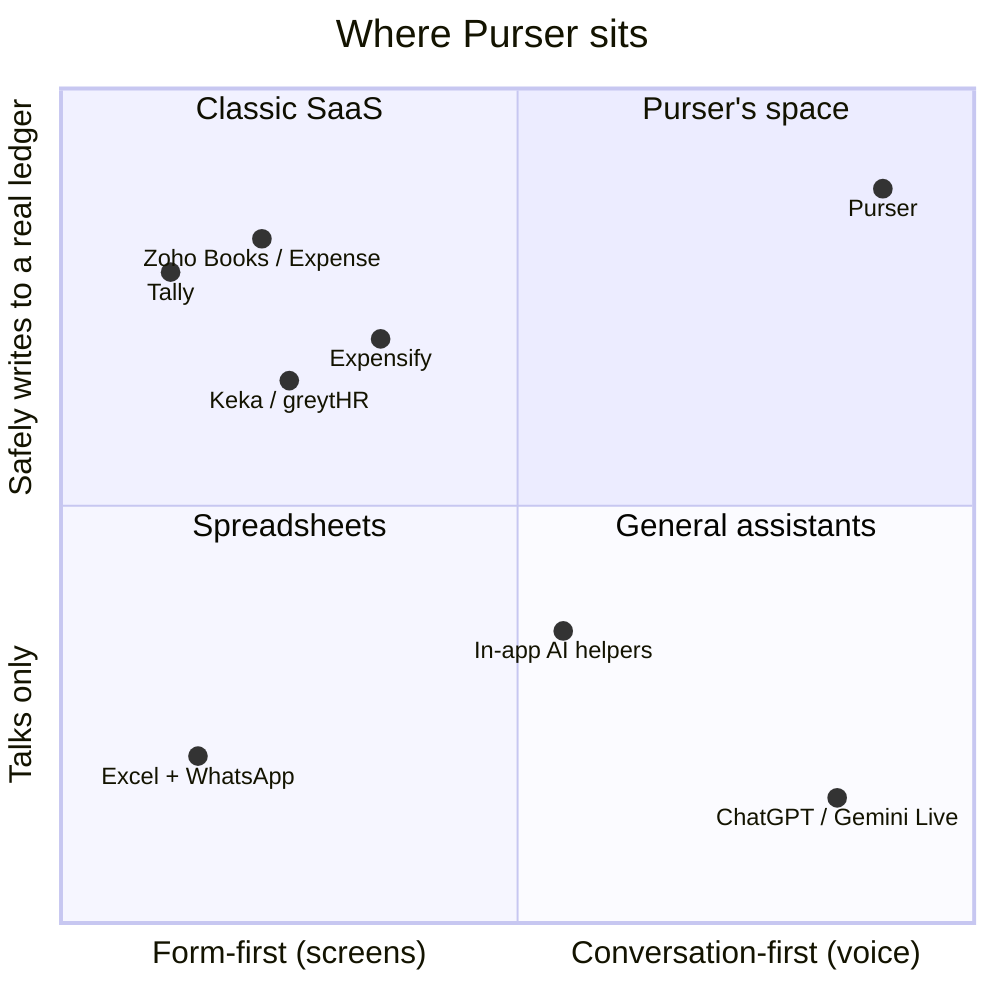

| | Zoho Books / Expense | Tally | Keka / greytHR | Expensify | General AI assistants | **Purser** |
|---|---|---|---|---|---|---|
| Finance + HR + revenue + contracts in one place | Finance only (HR is a separate product) | Accounting | HR only | Expenses | ✗ (no ledger) | ✅ |
| Voice is the main interface | ✗ | ✗ | ✗ | ✗ | ✅ | ✅ |
| Hindi / Hinglish conversation | ✗ | ✗ | ✗ | ✗ | Partial | ✅ |
| AI takes multi-step actions | Assistant features | ✗ | ✗ | Receipt scanning | Talks, can't post to your books | ✅ 99+ tools |
| Server-verified confirmation before any write | n/a | n/a | n/a | n/a | ✗ | ✅ |
| Every spoken number comes from SQL | n/a | n/a | n/a | n/a | ✗ | ✅ |
| Charts built on demand by voice | Fixed reports | Fixed reports | Fixed reports | Fixed reports | Ad hoc, unverified | ✅ typed spec |

*Competitor columns describe each product's core experience as we understand it. Several vendors are adding AI features; the gap we target is voice-first plus safe writes to the books.*

> **Our position:** classic SaaS is safe but form-heavy and English-first. AI assistants are fluent but can't safely touch the books. **Purser is the first to offer both: you talk naturally, and the books stay correct.**

---

## 🏗️ Act 7: how it is built (AWS)

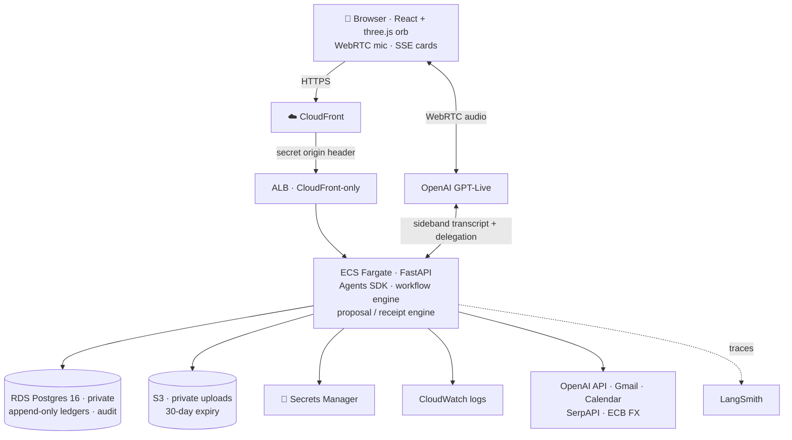

| Layer | Choice | Why |
|---|---|---|
| Voice | OpenAI GPT-Live, WebRTC + sideband | Low-latency speech; the server hears the confirmation itself |
| Agent | OpenAI Agents SDK + our checklist workflow engine | Typed tools; a cheap model by default, a strong one only when needed |
| Models | `gpt-6-luna` (workflows), `gpt-6-sol` (escalation), `gpt-5.4-mini` (fast paths) | All configurable via environment variables |
| Data | PostgreSQL + Alembic, append-only ledgers | Auditable money; data persists across deploys |
| Infra | Terraform: CloudFront → ALB → Fargate, private RDS, S3, Secrets Manager | 1 vCPU / 2 GB, about **$0.12/hour**. No GPU, no Bedrock (organiser rule) |
| Observability | CloudWatch logs, `/health`, LangSmith agent traces | See every tool call and its cost |

---

## 🎥 Act 8: live demo (about 6 minutes)

Full script with expected results: [`DEMO.md`](DEMO.md)

```mermaid
timeline
    title Golden path + spotlights (all on the live AWS URL)
    0:00 : Log in as admin : Spoken role briefing
    0:30 : Drop a FRESH receipt : "Arjun ne pay kiya tha" : "approve kar do" → "haan" : Travel ₹45,000 → ₹45,200
    1:30 : "Kaun paisa dena baaki hai?" : "sirf overdue" : "Acme ka amount padho"
    2:15 : ✈️ Flight + hotel search : "sabse sasta dono book karo" → "haan" : itinerary emailed + checkout links
    3:15 : 📜 Drop the MSA : "kaunse liabilities humpe hain?" : "agle 60 din ki deadlines"
    4:15 : 🔁 "Monday routine banao…" → "haan" : "Monday routine chalao"
    5:00 : 🛡️ Employee asks for budget → refused : CEO tries a change → read-only
    5:30 : Proof: "Is claim ki history batao" : log out/in → data persisted
```

---

## 🧾 Act 9: honesty and limits

| ✅ Real | ⚠️ Simulated / limited |
|---|---|
| Live AWS deployment, real OpenAI voice and agent calls | Company, people, vendors and clients are **synthetic** |
| Real Gmail + Calendar for one linked login | Flight/hotel **booking** hands off to the vendor; Purser takes no payment |
| Live flight/hotel fares (SerpAPI) and ECB FX rates | The eval is **text-path, single runs, 90 turns**; voice was not evaluated end to end |
| Persisted ledgers, audit trail, receipts in RDS | Jul–Sep budget actuals are a synthetic "imported snapshot" |

Built with Claude Code under the builder's direction. Budget, revenue and contract logic were reused from the builder's own earlier project and are disclosed file by file. Full details: [`HONEST_NOTE.md`](HONEST_NOTE.md).

---

## 🚀 Closing

```mermaid
flowchart LR
    A["🗣️ Speak naturally<br/>Hindi · Hinglish · English"] --> B["🤖 Purser does the routing<br/>67 workflows · 99+ tools"]
    B --> C["🛡️ Server-verified yes<br/>numbers from SQL"]
    C --> D["🧾 Receipt + audit trail<br/>on AWS"]
```

### Purser in three lines
1. **The whole back office in one voice agent:** finance, budgets, revenue, contracts, HR, mail, travel.
2. **Safe by construction:** the AI proposes, the server verifies a spoken "haan", and code writes the ledger.
3. **Engineered to be efficient:** 100% task success at **6x fewer tokens** and **8.7x lower cost** than a single agent.

> **"Priya doesn't need another dashboard. She needs a Purser."**
